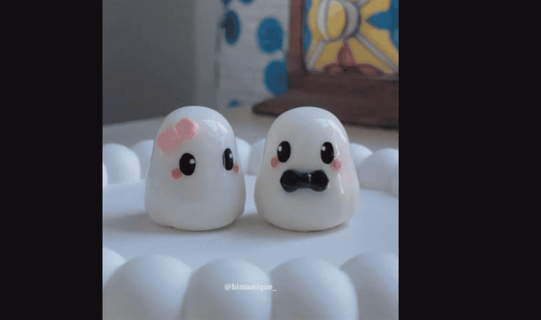

<div align="center">

# 🥟 Fluffy Maker

**Interactive WebGL2 squishy cheek physics screen overlay for Hyprland (Wayland)**

[](https://github.com/hyprwm/Hyprland)
[](https://archlinux.org)
[](https://www.khronos.org/webgl/)
[](LICENSE)

*Select any character, avatar, or anime wallpaper on your desktop and pinch, stretch, and wobble their cheeks in real time with smooth spring physics and squishy WebAudio sound effects.*

</div>

---

## 🎬 Demo

<div align="center">
  
  <p><i>Capture a screen region, paint the squishy mask, and pull cheeks with interactive spring physics.</i></p>
</div>

---

## ✨ Features

- **Instant Region Snapping**: Press `SUPER + F` and drag with `slurp`. Fluffy Maker captures the region with `grim` and immediately spawns a borderless floating overlay snapped 1:1 over your screen.
- **WebGL2 Spring Dynamics**: Verlet integration, quintic smootherstep falloff deformation, dynamic volume preservation (bulge), and synthetic WebAudio sound effects running smoothly at 60–144+ FPS.
- **Minimal Pastel Rice Aesthetic**: Sleek frosted-glass pill (`rgba(255, 255, 255, 0.88)` with background blur) featuring only 3 essential controls (`🖌️ Paint`, brush slider, and `✨ Play!`) plus a circular top-right close button.
- **Showcase / Screen-Recording Mode**: In `Play!` mode, UI controls softly fade out (`opacity: 0.35`) so screen recordings and rices remain completely clean. Hovering reveals full opacity.
- **Zero Launch Flash**: Transparent RGBA Cairo window surface and deferred WebKit frame commit prevent white flicker on Wayland.
- **Workspace-Bound & Movable**: Stays strictly on the workspace where the screenshot was taken. Move the overlay window anytime via Hyprland's `SUPER + Left-Click-Drag` or **Right-Click-Drag** anywhere on the canvas.

---

## ⚡ Quick Install & Setup

### 1. Install System Dependencies

On Arch Linux / CachyOS / EndeavourOS:

```bash
sudo pacman -S slurp grim python-gobject webkit2gtk-4.1
```

*(Node.js and npm are only needed if modifying and rebuilding `engine/`).*

### 2. Clone Repository

```bash
git clone https://github.com/basantbansal/fluffy-maker.git
cd fluffy-maker
chmod +x fluffy-maker.sh wrapper.py
```

*(Production WebGL assets in `engine/dist` are already pre-built and ready to run immediately).*

### 3. Add to Hyprland Config

Add the trigger keybind to `~/.config/hypr/UserConfigs/UserKeybinds.conf`:

```hyprlang
# Fluffy Maker interactive squishy overlay (SUPER + F)
bindd = $mainMod, F, Fluffy Maker squishy overlay, exec, /path/to/fluffy-maker/fluffy-maker.sh
```

Add the window rules to `~/.config/hypr/UserConfigs/WindowRules.conf` (Hyprland 0.53+):

```hyprlang
# Fluffy Maker Interactive Overlay
windowrule = match:class ^(fluffy-maker)$, float on
windowrule = match:class ^(fluffy-maker)$, border_size 0
windowrule = match:class ^(fluffy-maker)$, no_blur on
windowrule = match:class ^(fluffy-maker)$, no_shadow on
```

Reload Hyprland:

```bash
hyprctl reload
```

---

## 🎮 Controls

| Action | Input |
|---|---|
| **Trigger Fluffy Maker** | `SUPER + F` (click & drag area with mouse; `Esc` to cancel) |
| **Paint Mask Mode** | `🖌️ Paint` button, or press `P` / `1` |
| **Adjust Brush Size** | **Scroll mouse wheel** on canvas in Paint mode, use slider, or `[` / `]` |
| **Squish / Play Mode** | `✨ Play!` button, or press `Space` / `S` / `2` |
| **Squish & Pull Cheeks** | Left-Click-Drag on painted character area in Play mode |
| **Move Overlay Window** | **Right-Click-Drag** anywhere on canvas, or `SUPER + Left-Click-Drag` |
| **Close Overlay** | Top-right `✕` button, or press `Escape` |

---

## 🛠️ Project Structure

```
fluffy-maker/
├── fluffy-maker.sh     # Self-contained launcher (duplicate prevention, slurp + grim)
├── wrapper.py          # Native GTK3/WebKit2 transparent Wayland wrapper
├── engine/             # Adapted WebGL2 squishy engine (Vite + TypeScript)
│   ├── dist/           # Pre-compiled client assets (no Node.js needed at runtime)
│   └── src/            # Physics, WebGL shaders, mask tool, and overlay UI
├── demo.gif            # Showcase GIF
├── README.md           # Documentation
└── LICENSE             # MIT License
```

To modify and recompile the TypeScript engine:
```bash
cd engine
npm install
npm run build
```

---

## 💖 Credits

- **Original WebGL2 Squishy Physics Engine**: Created by [@saba383810](https://github.com/saba383810) in [moti_hoppe_maker](https://github.com/saba383810/moti_hoppe_maker).
- **Hyprland Desktop Widget**: Built with Python GTK3, WebKit2GTK 4.1, `slurp`, and `grim`.
